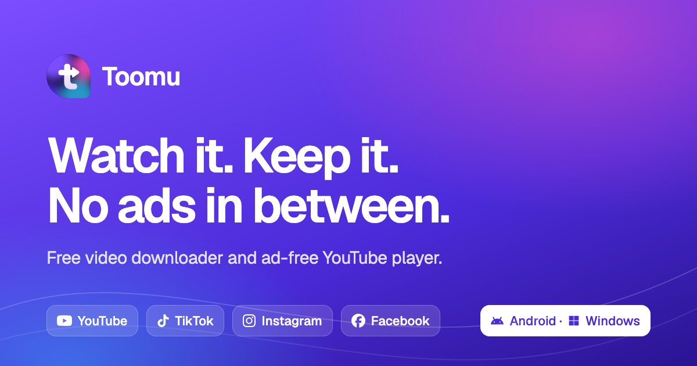

<div align="center">

<a href="https://sajjadhossainshohag.github.io/toomu/"></a>

# Toomu

**Free video downloader and ad-free YouTube player for Android and Windows.**

Save videos and music from YouTube, TikTok, Instagram, Facebook and almost any website, watch YouTube without ads, and keep it all offline. No ads, no account, no trial.

[](https://github.com/sajjadhossainshohag/toomu/releases/latest)
[](https://github.com/sajjadhossainshohag/toomu/releases)
[](https://github.com/sajjadhossainshohag/toomu/actions/workflows/build.yml)


[](LICENSE)

**[Website](https://sajjadhossainshohag.github.io/toomu/)** · **[Download for Android](https://github.com/sajjadhossainshohag/toomu/releases/latest/download/toomu-arm64-v8a.apk)** · **[Download for Windows](https://github.com/sajjadhossainshohag/toomu/releases/latest/download/toomu-windows-setup.exe)**

</div>

## Download

| Device | File | Notes |
|---|---|---|
| Android 7.0 or newer | [toomu-arm64-v8a.apk](https://github.com/sajjadhossainshohag/toomu/releases/latest/download/toomu-arm64-v8a.apk) | Almost every phone from 2017 on. Older 32-bit phone? Get the armeabi-v7a build from [Releases](https://github.com/sajjadhossainshohag/toomu/releases). |
| Windows 10 and 11 (64-bit) | [toomu-windows-setup.exe](https://github.com/sajjadhossainshohag/toomu/releases/latest/download/toomu-windows-setup.exe) | Installer. Rather not install? Get the [portable .zip](https://github.com/sajjadhossainshohag/toomu/releases/latest/download/toomu-windows-x64.zip). |

Toomu isn't on the Play Store (Google doesn't allow apps that download from YouTube). Every version is published on [GitHub Releases](https://github.com/sajjadhossainshohag/toomu/releases), and the app updates itself from there.

## Features

**Download**
- YouTube, TikTok, Instagram and Facebook: share the link to Toomu or paste it on Home.
- Any quality up to 4K, or just the sound as MP3 or the original audio.
- Whole YouTube playlists and channels in one go; videos already saved are skipped.
- TikTok without the watermark.
- YouTube subtitles saved with the video.
- Up to 8 connections per file; a dropped connection resumes by itself.
- HLS and DASH streams saved as one file.

**Watch**
- YouTube without ads: search, your own feed when signed in, Shorts, watch later and history.
- Background play with the screen off, and a mini player (picture-in-picture).
- A floating button over the YouTube app that downloads what's playing.
- A video player for every video on your phone, by folder, at the speed you like.

**Browse**
- A Chrome-like browser with tabs, incognito, bookmarks, history and desktop site.
- It finds the videos and songs on any page, with their qualities, and stops ad pop-ups and redirects.
- An expired download link can be refreshed and the download carries on.

**Listen and keep**
- An offline music player with a queue, favourites, an equalizer and a sleep timer.
- A private folder that opens with your PIN or fingerprint.
- Light or dark theme. Your files stay on your device.

## FAQ

**Is Toomu really free?** Yes. No ads, no subscriptions, no paid tier and no account.

**How do I install the APK?** Download it on your phone and open the file. Android asks once to allow installs from your browser; then tap Install. From then on Toomu installs its own updates.

**Which sites does it work with?** YouTube, TikTok, Instagram and Facebook links download straight away. For other sites, open the page in Toomu's browser and it picks up the videos and audio that play there. Protected (DRM) streams such as Netflix can't be saved.

**Does the Windows app need anything else?** No. On first launch it fetches the tools it needs to download and convert video, and keeps them up to date.

## Build from source

Toomu is a [Flutter](https://flutter.dev) app (Flutter 3.41). Downloads use [yt-dlp](https://github.com/yt-dlp/yt-dlp) with FFmpeg.

```bash
flutter pub get
flutter analyze
flutter test
tool/build_release.sh              # release APKs (arm64, armv7)
flutter build windows --release    # on Windows, with Visual Studio's C++ workload
```

Found a bug or missing a feature? [Open an issue](https://github.com/sajjadhossainshohag/toomu/issues).

## License

Toomu is free software, licensed under the [GNU General Public License v3.0](LICENSE). You may use, study, share and change it; if you share a changed version, it must stay under the GPL-3.0 with its source code available.
